## About

This project uses standard ESPHome components to replace original Xiaomi firmware.

## How to use

### Compilation
 
Create an empty project in Esphome
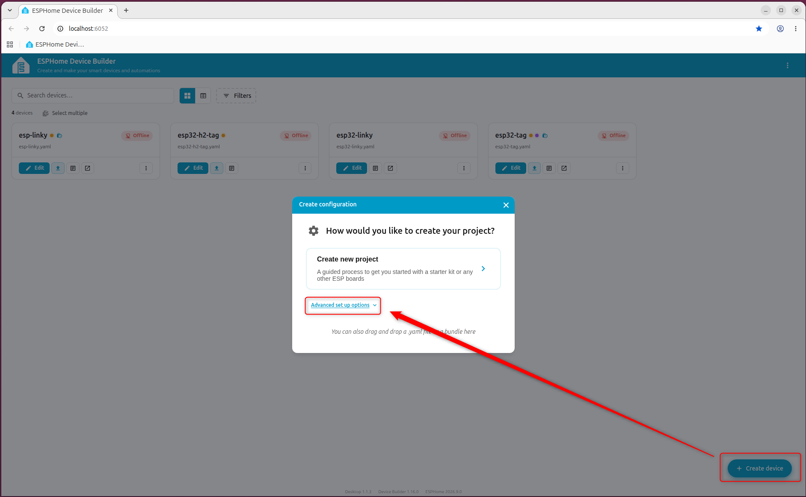
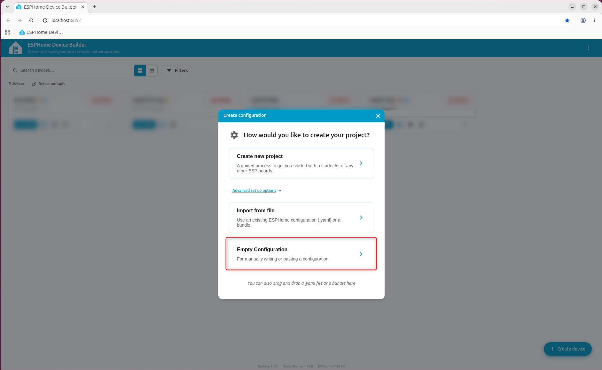
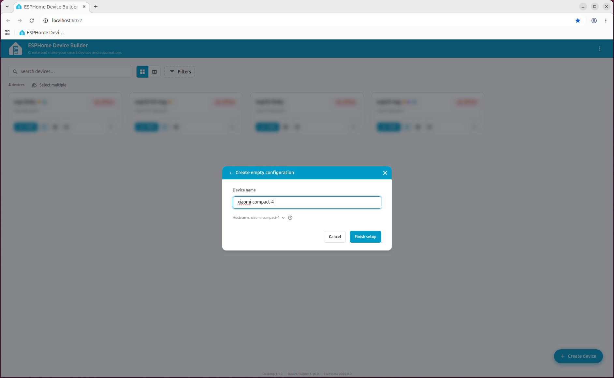

Copy and Past all code from "xiaomi-compact-4.yaml" then Clic on Install to Compile and download the binary
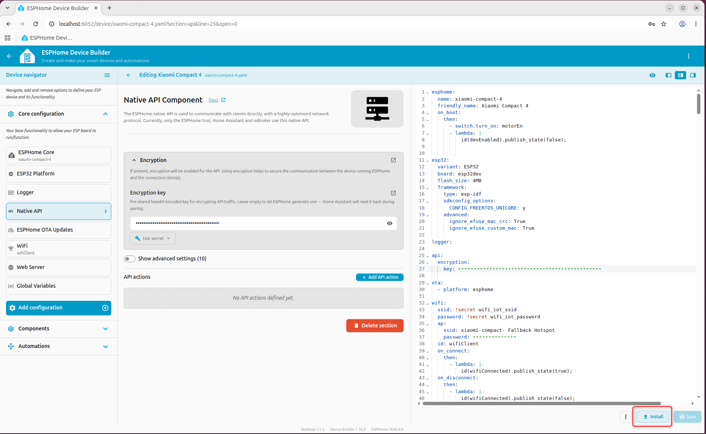
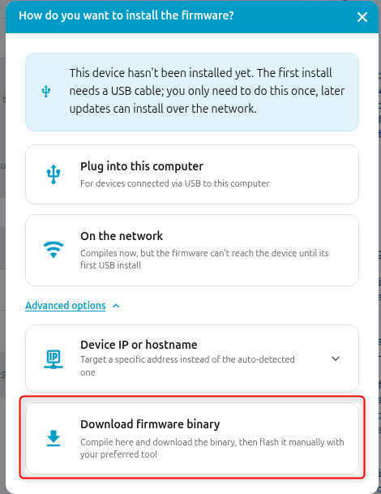
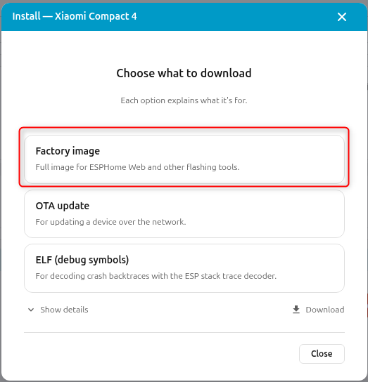

### Flashing
The device contains an ESP32-WROOM-32D module on the main PCB.
1. To replace original firmware, you need to disassemble the device and connect serial adapter to the pins next to ESP32:


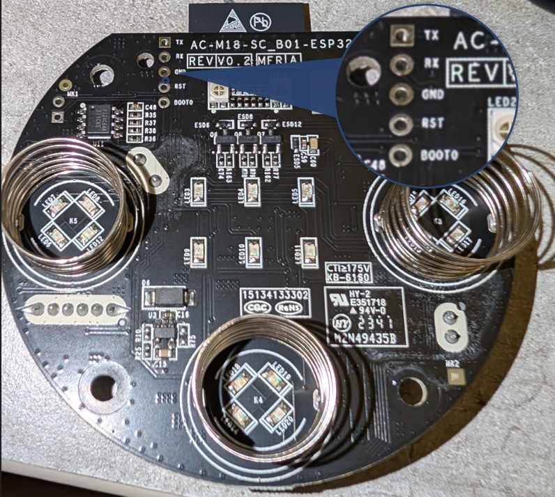

To activate the bootloader mode, you need to short GPIO0 to the GND while powering up the device.
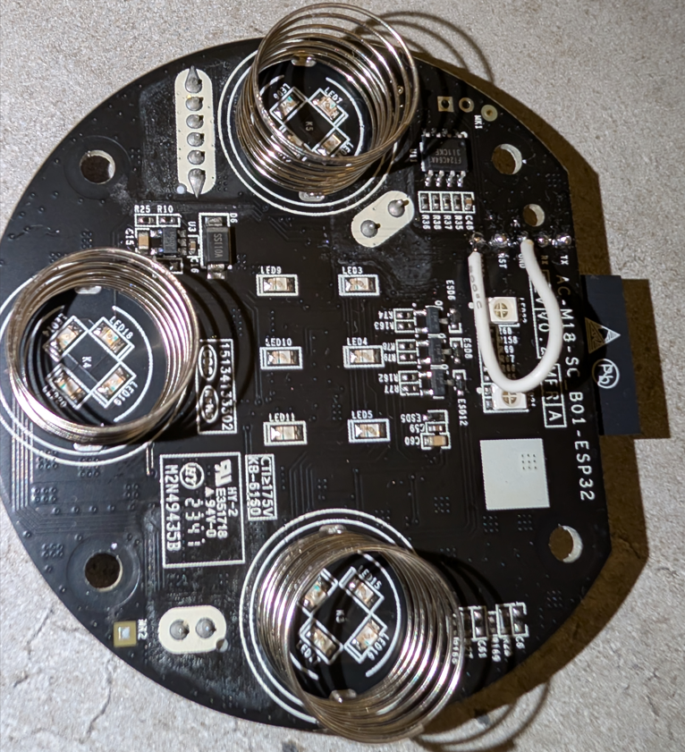

2. Debian/Ubuntu:

- Get python package:
```shell
sudo apt install python3.14-venv
```
- Create virtual env. :
```shell
sudo python3 -m venv esptoolenv
```
- Activate it:
```shell
source esptoolenv/bin/activate
```
- Install lastest esptool:
```shell
pip install esptool
```
3. Backup your original firmware in case you need to restore it:
```shell
esptool --port /dev/ttyUSB0 --baud 115200 read_flash 0x00000 0x400000 backup_xiaomi_compact_4.bin
```
4. Write ESPHome firmware to the flash. You can use ESPHome dashboard for that. The other option is to use `esptool`:
```shell
esptool --port /dev/ttyUSB0 --baud 115200 write-flash 0x00000  my_firmware.bin
```
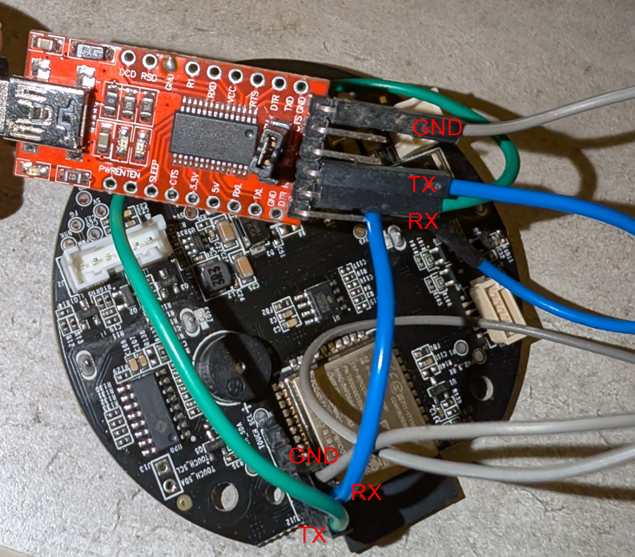

Remerber, the device must be power up
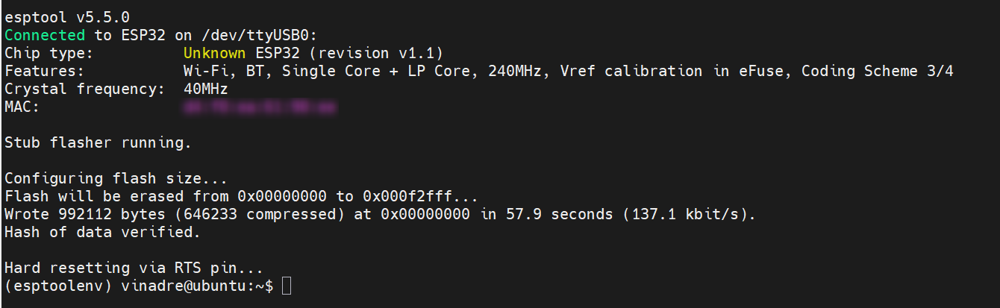

4. At this stage, ESPHome OTA updates should be functional.
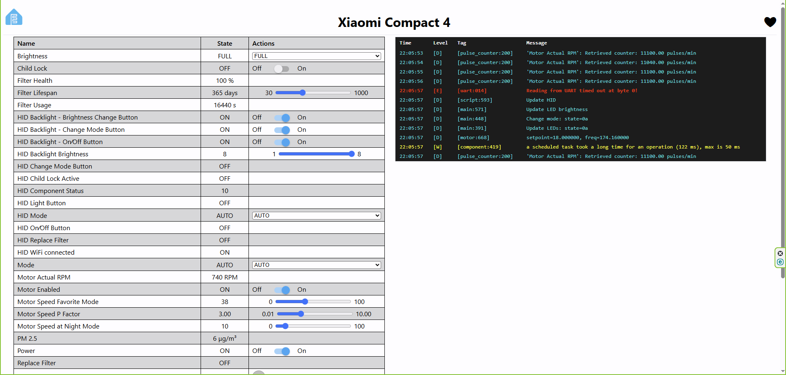

5. You can add the device in Home Assistant
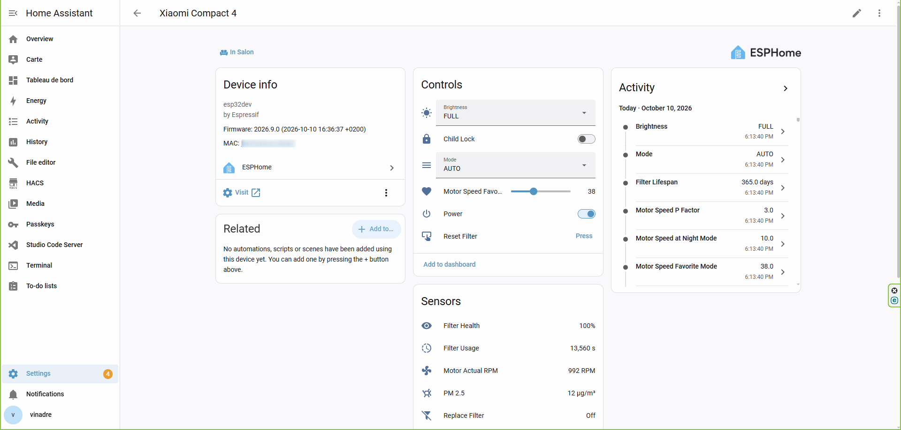

