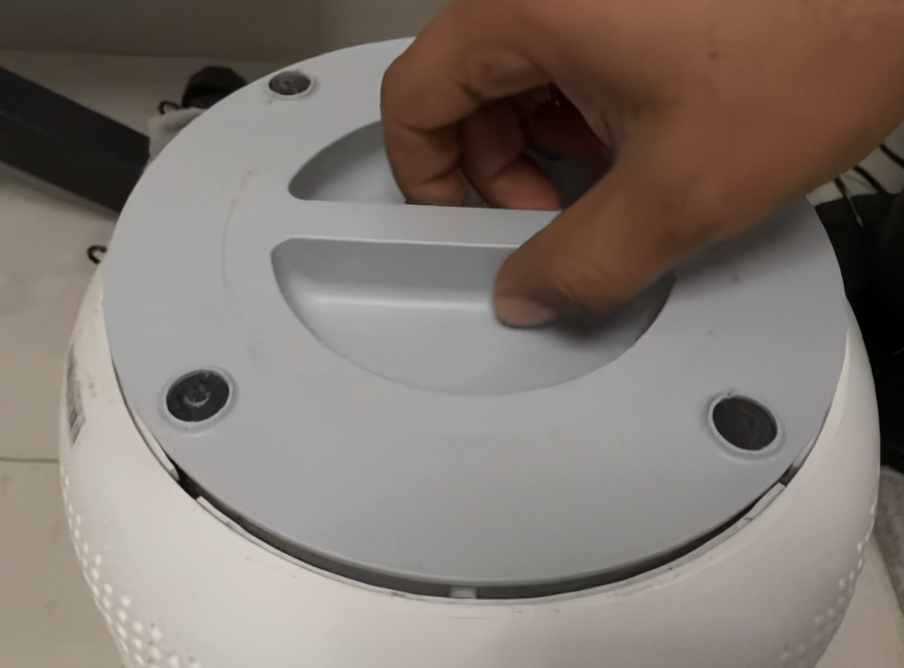
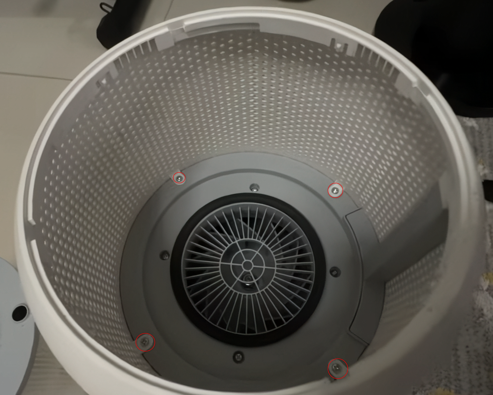
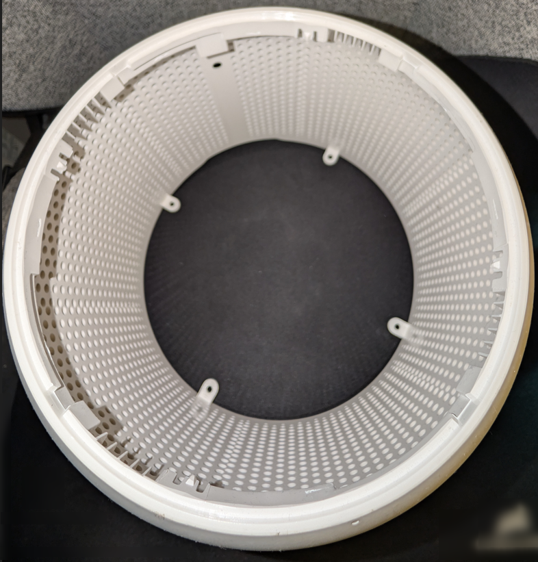
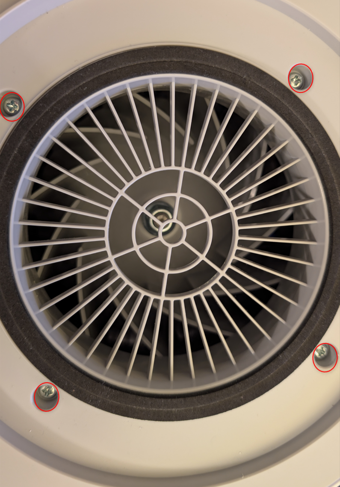
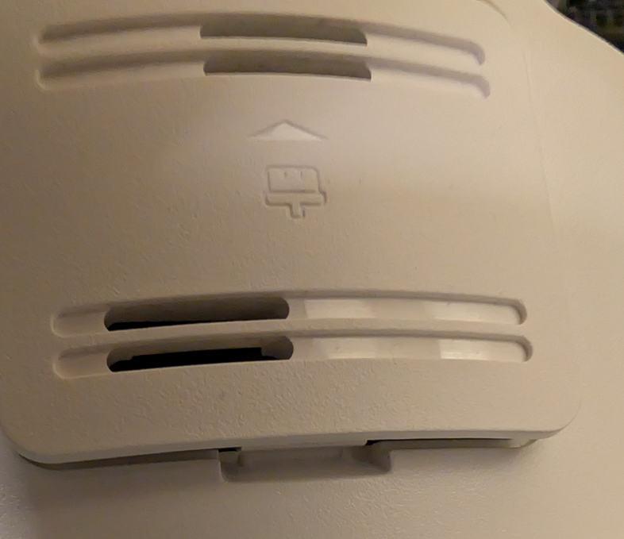
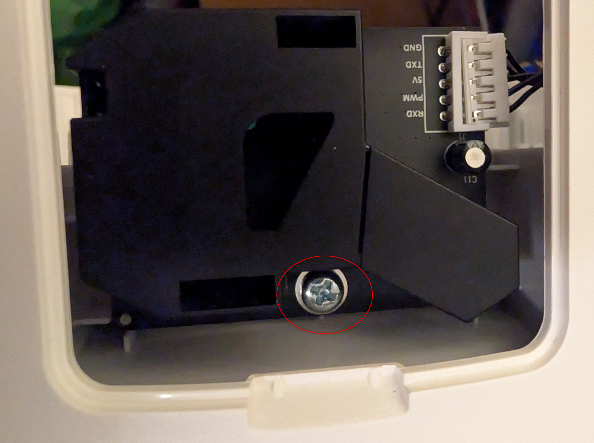
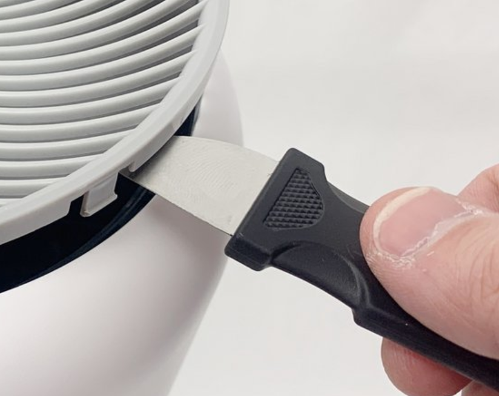
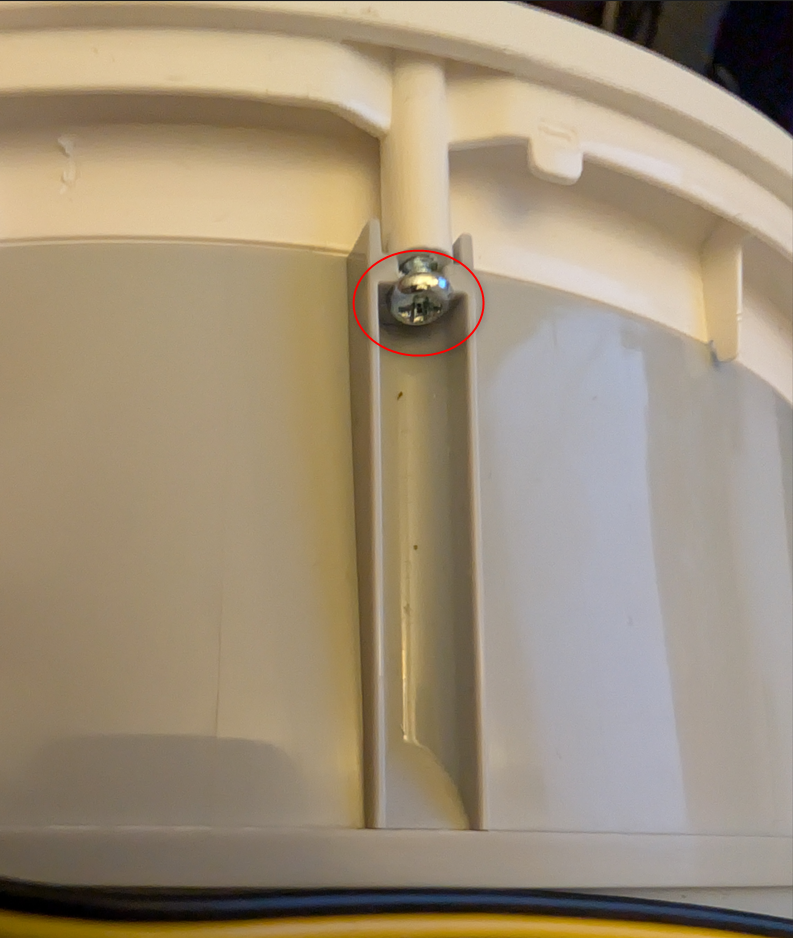
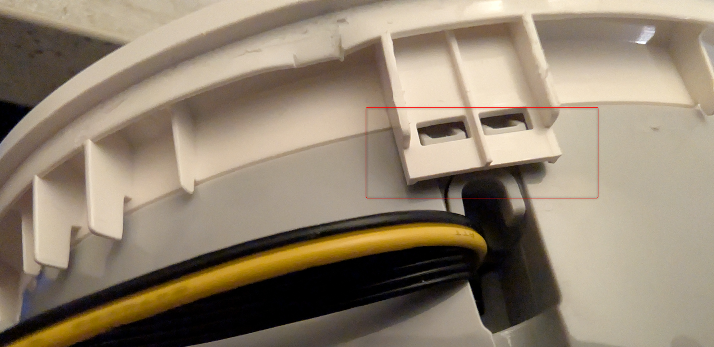
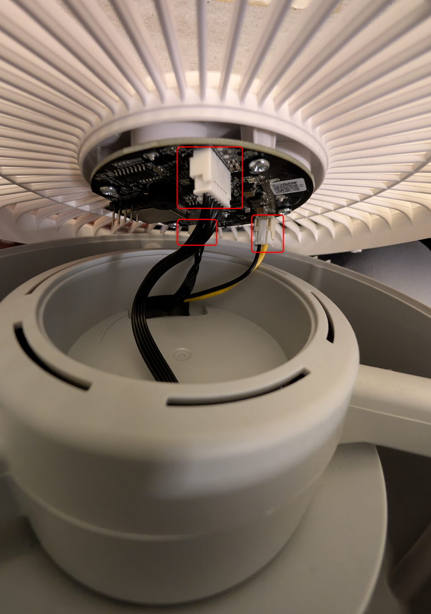

1. Remove the filter:

2. Remove all the screws from the filter housing (4):

3. Remove all the screws from the motor housing (4):

4. Remove the hatch and remove the screw (1):

6. Use a thin tool to remove the top cover:

7. Remove all the screws (3):

8. Use a thin tool to unclip :

9. Disconnect all connector (push to release):

